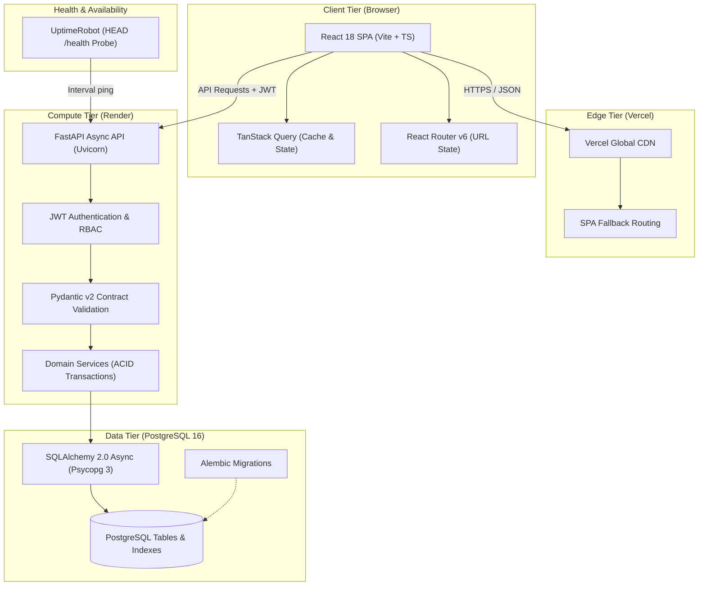
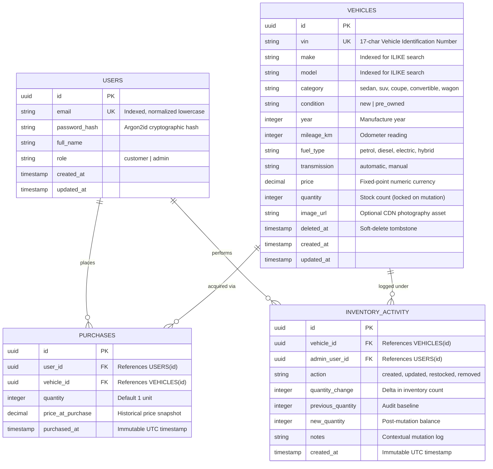
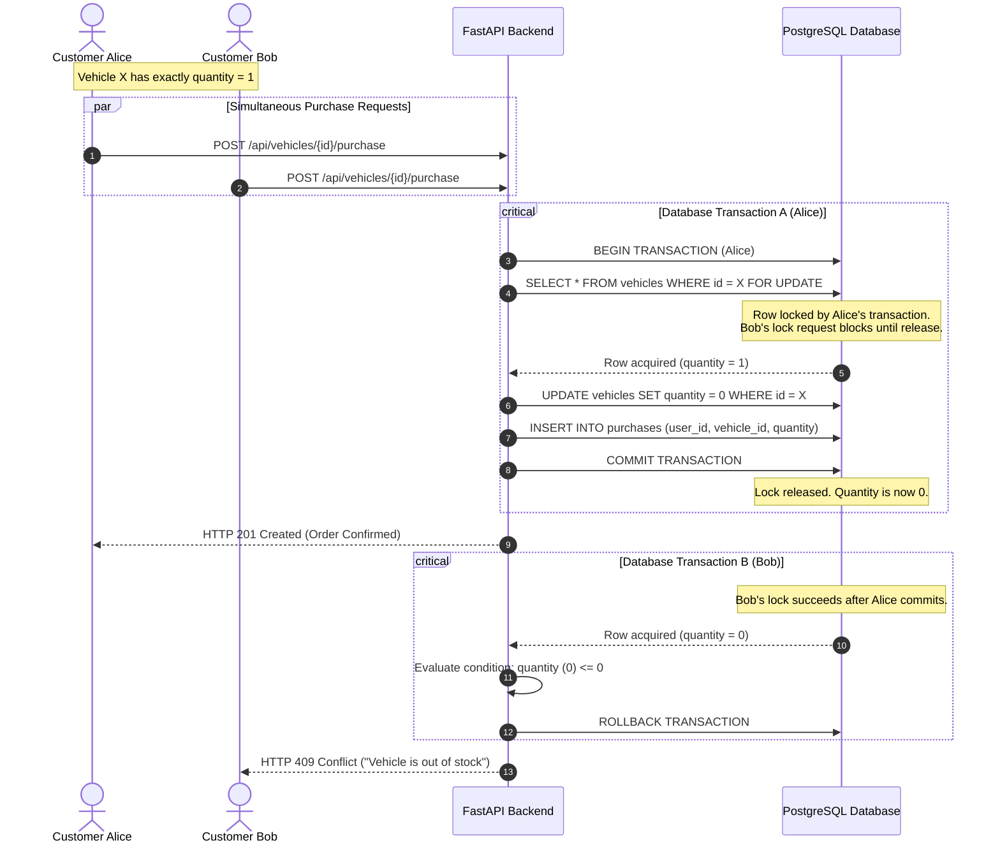
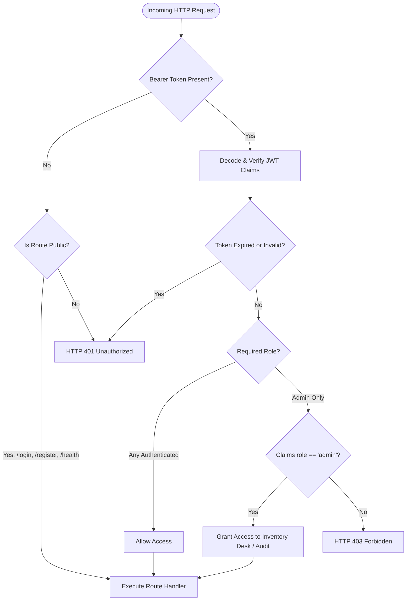

# Aretiva Motors — System Architecture & Design

> Engineered through every iteration.

This document describes the architectural topology, data models, concurrency control mechanisms, and security boundaries implemented in Aretiva Motors.

---

## 1. System & Deployment Topology

Aretiva Motors is built as a clean, decoupled full-stack architecture separated into a modern single-page frontend (Vercel) and an asynchronous REST API backend with ACID-compliant storage (Render & PostgreSQL).

---

## 2. Domain Data Model & Entity Relationships

The domain model guarantees immutability for past customer transactions while enforcing soft-deletion and strict audit trails for administrative inventory management.

---

## 3. Concurrency & Pessimistic Locking Sequence

To eliminate overselling race conditions when multiple customers simultaneously request the final available unit of an exotic vehicle, Aretiva implements **Pessimistic Row-Level Locking** using PostgreSQL's `SELECT ... FOR UPDATE`.

---

## 4. Role-Based Access Control (RBAC) & Security Boundary

Every mutation route in the system enforces strict zero-trust claims verification. Tokens are cryptographically validated against `JWT_SECRET` (HS256) with verified issuer and audience claims.

---

## 5. Architectural Correctness Guarantees

1. **No Negative Stock**:
   Stock can never drop below zero. Every purchase is conditionally guarded within a pessimistic lock.
2. **Auditable Inventory State**:
   Direct vehicle attribute updates (e.g. price, description) are structurally separated from stock mutations (restock, purchase), ensuring every unit change leaves an immutable trace in the `inventory_activity` ledger.
3. **Soft Deletions**:
   Deleting a vehicle preserves referential integrity for previous purchase receipts and audit records by setting `deleted_at = NOW()` rather than destructive `DELETE`.
4. **Resilient Production Probes**:
   The API provides explicit support for both `GET /health` and `HEAD /health` protocols to support third-party ping monitors (like UptimeRobot) without generating 405 Method Not Allowed errors.
