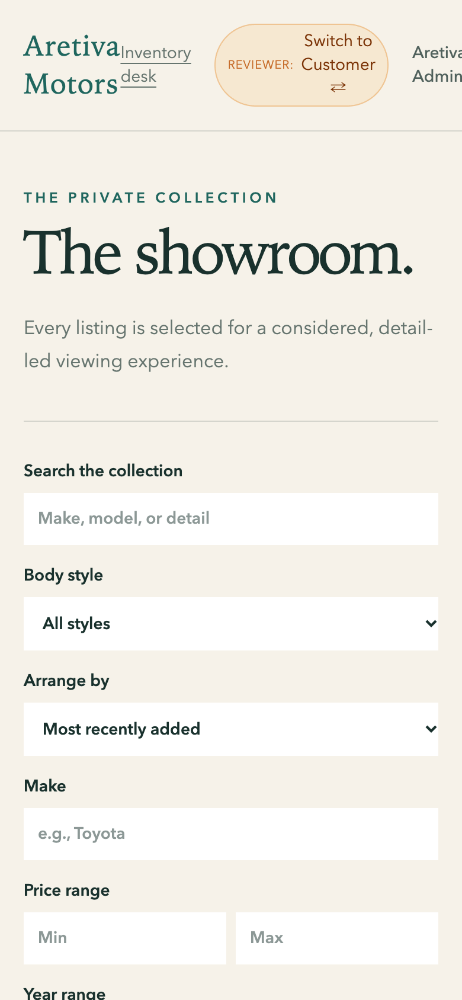

# Application Visual Gallery & Screenshots

This gallery showcases the primary customer acquisition workflows, administrator controls, and luxury styling implemented across **Aretiva Motors**.

---

## 1. Landing Page & Editorial Hero
> *Museum-grade Verdigris visual design, brand manifesto, and instant 1-click reviewer authentication shortcuts.*

---

## 2. Private Curated Showroom
> *Tolerant case-insensitive search (`ILIKE`), multi-parameter filters (categories, price/year intervals), active filter dismissal chips, and real-time result counters.*

---

## 3. Side-by-Side Luxury Comparison
> *Floating compare drawer (`Compare (2/3)`) and full-screen specification review comparing silhouettes, powertrains, transmissions, certified mileage, and monthly investment.*

---

## 4. Vehicle Detail & Bespoke EMI Financing Estimator
> *Dynamic financial amortization engine at 8.5% APR with 20%, 30%, and 50% down payment presets and 36, 48, or 60-month tenures.*

---

## 5. Concierge Delivery Lifecycle Tracker (Customer View)
> *Embedded 4-stage white-glove delivery stepper (`Acquisition Confirmed` ➔ `Custom Detailing` ➔ `En Route` ➔ `Handover Ready`), deterministic tracking codes (`AM-TRK-...`), and protocol status updates.*

---

## 6. Luxury Certificate of Acquisition & Printable Receipt
> *Official certificate modal with collector details, timestamp, VIN verification, and clean browser print styling.*

---

## 7. Administrator Inventory Desk & Low-Stock Alerts
> *Fleet inventory desk with low-stock warning badges (`Only 1 left!`), instant stock replenishment, and new vehicle creation.*

---

## 8. Live Administrator Activity & Transaction Ledger
> *Real-time audit trail recording every purchase and restock event with timestamp, vehicle model, quantity deltas, and collector identity.*

---

## 9. Administrator Concierge Delivery Management
> *Full administrative control over client delivery lifecycles with stage selector and 1-click `Advance ➔` button that synchronizes with the customer's portal.*

---

## 10. Responsive Mobile Showroom UX
> *Adaptive mobile layout with touch drawer navigation, condensed vehicle cards, and responsive filter interactions.*

